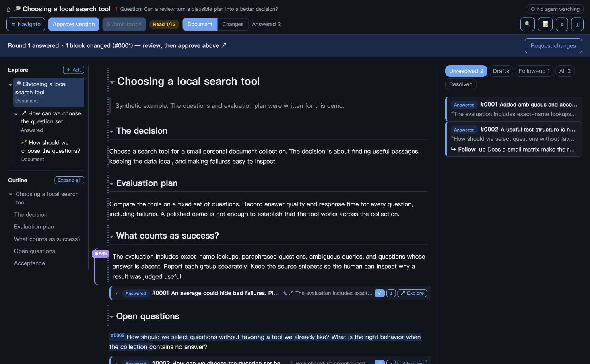

# Agent Review Board

**Keep a branching conversation next to the document it is changing.**

A local Markdown review surface for a human working with a coding agent. Select a
passage, ask a question, follow up in its thread, and inspect what changed in the
document. Your existing agent answers through a CLI; the board does not call a model.



Derived from the working v2.7 implementation, this package includes an English
interface and CLI, a usage guide, and synthetic examples. macOS and Linux are
supported. Python 3.10+ is required;
the server uses the standard library. Browser dependencies are vendored.

## Try the disposable demo

```sh
git clone https://github.com/willabel4112/agent-review-board.git
cd agent-review-board
python3 examples/demo.py
```

Open the printed loopback URL. The demo contains a synthetic research plan,
comments, a document revision, and a child document. You can add comments and
explore branches. It uses a temporary directory and a random port; Ctrl-C removes
its data. Replies are seeded examples, not automatic AI responses.

## Review your own document

```sh
python3 boardctl.py register /absolute/path/plan.md --id plan --title "Project plan"
python3 server.py
```

Open `http://127.0.0.1:8798/d/plan`. In another terminal, or through your agent:

```sh
python3 boardctl.py pending --doc plan --json
python3 boardctl.py reply plan c-0001 --file answer.md --summary "The short conclusion"
```

For a requested change, the agent edits the source Markdown, commits that change
in its repository, then associates the result with the comment:

```sh
python3 boardctl.py answer-edit plan c-0001 --commit COMMIT_SHA --summary "Updated the acceptance criteria"
```

The browser displays changed blocks and a version comparison. The human decides
when a thread is resolved or a reviewed version is approved.

Give your agent [the workflow instructions](AGENTS.md). See [the full usage guide](docs/USAGE.md)
for session identity, waiting, child documents, storage and service installation.

## Why this exists

I would ask five questions. The agent would answer them and introduce three more.
My next message would refer to a mixed subset of both lists. The discussion had
become a tree, while the interface still offered a single stream.

The board grew from a request to render an existing project document and let me
comment where I was reading. It needed to be a reusable place to work: questions
should stay attached to passages, decisions should change the document, and I
should be able to see those changes before accepting them.

Two experiences shaped it:

- A long research report became useful through dozens of comments and several
  waves of follow-up. Longer answers became linked documents, and a conclusion
  moved into a maintained policy. The first draft was only the start.
- Reviewing the board itself exposed a failure: replies could accumulate while
  the specification barely changed. Better commenting UI was insufficient. The
  agent workflow had to distinguish explaining a decision from applying it.

[Origin and usage cases](docs/ORIGIN-AND-CASES.md) describe the evidence and its limits.
The included examples are explicit reconstructions, not original transcripts.

## What the current version does

| Need | Mechanism |
|---|---|
| Ask about a particular claim | Selection or block anchors, stable comment IDs, threaded follow-ups |
| Think before sending | Drafts, immediate delivery, or batch submission |
| Check whether an opinion changed the work | Source revisions, snapshots, block diffs and review rounds |
| Explore a tangent without losing your place | Question branches, child documents and a reversible reading stack |
| Tell whether someone has read the result | Explicit read/approval actions; silence does not imply acceptance |
| Keep long answers readable | One-line conclusions and linked answer documents |
| Keep work across sessions | Markdown plus append-only sidecar events; local registry and claims |

The exploration tree is a navigation view. It does not automatically fork agents,
select context, isolate model memory or provide a background answering service.

## Local use and data

The server binds to `127.0.0.1`. Use trusted documents on your own machine. It is
a single-user development tool, with no authentication or public-hosting boundary.
Markdown can contain HTML, and document-relative asset routes serve neighboring
files inside a registered document's directory. Do not expose the server to the
internet or point it at untrusted document collections.

Private notes and drafts are excluded from the normal agent pending queue. They
are still files on the same machine, visible to its owner and browser UI; this is
a workflow boundary, not encryption or OS-level isolation. Review sidecars before
sharing a document repository.

This release includes no original registry, comments, snapshots, session history,
network inventories or production screenshots. See [publication notes](docs/PUBLICATION.md).

## Check the implementation

```sh
python3 tests/test_lib.py
python3 tests/test_explore.py
python3 tests/test_public.py
node tests/test_navigation.js
```

Node is only needed for the JavaScript tests. [Architecture](ARCHITECTURE.md) explains
the storage model and invariants. [Release notes](CHANGELOG.md) distinguish the
working feature set from changes made for this public package.

MIT for original code and documentation; vendored dependencies retain their own
licenses in [THIRD-PARTY-NOTICES.md](THIRD-PARTY-NOTICES.md).
